 

   

 

### 👋 About me

I'm a **Computer Systems Engineering student** at Universidad Privada Boliviana (8th semester · GPA 96/100 · Top 5 in program) and a **Full-Stack Developer at [Waveware Solutions](https://wavewaresolutions.com)**, working remotely with a U.S. team.

I build backend services with **clean architecture** and back them with **automated tests**. I'm most interested in running untrusted code safely, real-time systems, and applications built on LLMs. I pick up new stacks fast and want to grow as a product engineer who ships software end to end.

 

### 🧭 Journey

<b>💼 Experience details</b>

 

**Waveware Solutions** · United States (Remote)

- **Full-Stack Software Developer (part-time)** · Sep 2026 – Present
  - Frontend features and backend services for blockchain and Web3 products in a distributed, English-speaking team.
- **Full-Stack Software Engineer Intern** · Feb 2026 – Aug 2026
  - Built an Express.js service for a government platform and validated throughput of up to **10,000 requests/minute** with k6.
  - Designed reusable service templates with **hexagonal architecture**, so business logic is tested without databases or external APIs.
  - Wrote **300+ Cypress end-to-end tests** covering critical API and user workflows.

**Leadership**

- **Teaching Assistant, UPB** (2023 – Present): Algorithms I and Calculus I.
- **Treasurer, IEEE Student Branch** (2025 – Present): organized technical events and hackathons.

 

### 🚀 Featured projects

  
  
  
  
  

  

 

### 🛠️ Tech stack

  
   <b>Languages</b>  
  
   <b>Backend · Frontend · Mobile</b>  
  
   <b>Data &amp; AI</b> · pgvector · RAG · LLM APIs (Gemini, Claude)  
  
   <b>Testing &amp; DevOps</b> · k6 · pytest · Helm

<b>Practices:</b> hexagonal architecture · automated testing · CI/CD · code review · ADRs

 

### 📊 GitHub activity

  
  

<picture>
  <source media="(prefers-color-scheme: dark)" srcset="https://raw.githubusercontent.com/CamiloRaphaelZuletaWolff/CamiloRaphaelZuletaWolff/output/snake-dark.svg"/>
  <source media="(prefers-color-scheme: light)" srcset="https://raw.githubusercontent.com/CamiloRaphaelZuletaWolff/CamiloRaphaelZuletaWolff/output/snake.svg"/>
  
</picture>

 

### 🏆 Achievements

- 🥇 **Hackathon winner:** “Soluciones para mi ciudad”, La Paz municipal government (July 2026), with superAMI and a six-person team
- 🧠 **ICPC:** regional competitor in 2024 and 2025 · **Top 8 in Bolivia** (2025)
- 🎓 **Academics:** GPA 96/100 · Honor Program (Top 30 academic profiles) · Top 5 in program
- 🌎 **Languages:** Spanish (native) · English (advanced, C1)

 

